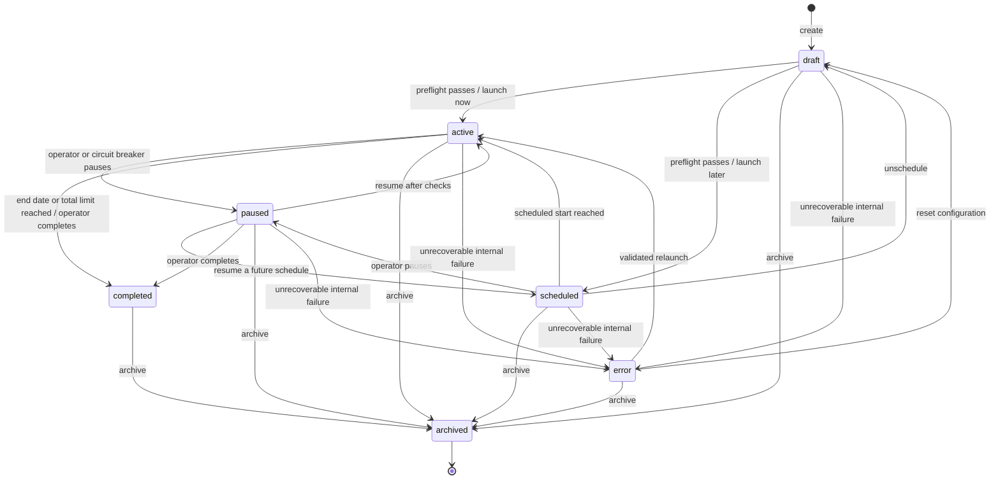

# Campaign lifecycle and durable delivery jobs

The Ads Manager uses `AdsCampaign.status` for lifecycle state and a separate
`AdsCampaignJob` row for resumable dispatch work. A campaign transition and its
audit record are committed together in `ads_campaign_state_transitions`.

## Guardrails

- `draft → active` and `draft → scheduled` require a preflight pass: a usable
  sender, a non-empty eligible audience, active creatives, complete content,
  known/resolvable personalization tokens, and valid follow-up steps. A failed
  launch leaves the campaign in its existing state and stores actionable
  `last_error` text.
- Provider connectivity is tested for live email launches. SPF/DKIM/DMARC
  authentication is shown as a warning so the operator can fix DNS without
  silently preventing launch.
- `paused`, `completed`, and `archived` are not assigned directly by the API;
  the transition helper checks the graph and records actor, reason, timestamp,
  and optional error. Invalid transitions return a readable conflict.
- Each launch creates or wakes a persistent `AdsCampaignJob`. Redis/Celery is a
  wake-up/throughput optimization; the job row is the source of truth, and the
  inline poller recovers due work after broker or worker outages.
- A job stores status, progress, attempts, worker id, schedule, result, and
  error. Temporary provider failures are stored on the message and send log;
  rate limits retry after 60 seconds and other transient failures use
  exponential backoff, with at most five automatic provider attempts.
- `daily_limit: null` is unlimited for an email sender when the account marks
  it as an intentional unlimited choice. It does not inherit a legacy sending
  rules cap.

## Health and activity surfaces

- `GET /api/v1/email/health` reports stored Brevo sender health. The existing
  `POST /api/v1/email/accounts/{id}/test` runs a live Brevo check and saves the
  result.
- `GET /api/v1/system/health` reports database, Redis, Celery worker, inline
  poller, and persistent campaign-job health.
- `GET /api/v1/ads/campaigns/{id}/jobs` and
  `GET /api/v1/ads/campaigns/{id}/send-logs` expose durable queue progress and
  readable per-attempt email outcomes without changing existing endpoints.
